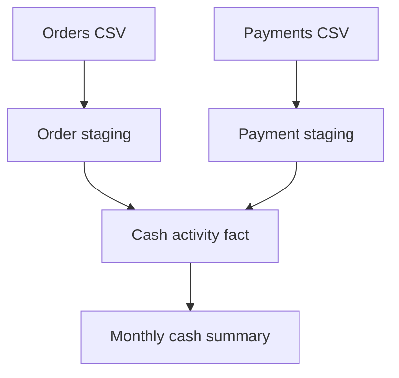

# Finance Cash Pipeline

An AI-assisted portfolio project that turns synthetic order and payment exports into a reconciled monthly cash report. It answers a finance question: how much cash did we collect, refund, and retain each month? The project runs locally with Python, dbt Core, SQL, and DuckDB.

| Local result | Value |
| --- | ---: |
| Source orders | 1,200 |
| Payment events | 1,344 |
| Reporting months | 12 |
| Gross collections | $183,150.20 |
| Refunds | $4,583.04 |
| Net cash | $178,567.16 |
| dbt data tests passed | 16 |
| Independently reconciled monthly rows | 12 of 12 |

The dates and amounts are simulated. The report tracks cash by payment event date. A February refund for a January charge reduces February cash. Order values, uncollected balances, and accrued revenue are outside the report's scope.

## Run the project

Tested with Python 3.12. Run these commands from the repository root.

```bash
python -m venv .venv
source .venv/bin/activate
python -m pip install -r requirements.txt
python scripts/run_demo.py
python scripts/prove_controls.py
```

On PowerShell, activate with `./.venv/Scripts/Activate.ps1`. Both runners use the active environment's dbt CLI. No account or cloud credentials are required for the local run.

- `run_demo.py` loads the committed fixtures and runs `dbt build`. It recomputes each month's count and cash amounts directly from the original payment CSV in Python. The script exports the ordered SQL result only after all monthly values match.
- `prove_controls.py` runs in a temporary project and verifies that dbt detects a one-cent difference, a duplicate payment ID, and a payment whose order is missing.
- `python scripts/generate_seeds.py` recreates the source CSVs deterministically. The fixtures include split and partial payments, canceled and uncollected orders, and cross-month refunds.

## Data model



| Model | Grain | Logic |
| --- | --- | --- |
| `stg_orders` | One order ID | Cast order dates and normalize statuses. |
| `stg_payments` | One payment ID | Cast payment dates and normalize event types. |
| `fct_cash_activity` | One payment event | Join eligible orders to payment events, assign the cash month, and sign refunds negative. |
| `monthly_cash_summary` | One month with payment activity | Count events and sum collections, refunds, and net cash. |

All amounts are integer USD cents. In the monthly CSV, `cash_month` is the first day of the month and `event_count` counts charges and refunds together. `charges_cents` and `refunds_cents` are positive magnitudes. `net_cash_cents` is their difference.

## Validation and outputs

| Control | What it checks |
| --- | --- |
| Grain and required fields | Unique, populated order and payment IDs, unique report months, and populated signed amounts. |
| Source integrity | Valid event types and order statuses, positive amounts, valid dates, and payments attached to eligible orders. |
| Cash rules | Charges stay within order value and cumulative refunds stay within collected cash. |
| Reconciliation | Fact rows preserve payment grain. Every report month agrees with raw payment counts, charges, refunds, and net cash. |
| Independent validation | Python recomputes all monthly totals from the input CSV and compares them with DuckDB output. |

- [Monthly report CSV](reports/monthly_cash_summary.csv)
- [Build validation results](reports/validation.json)
- [Injected failure results](reports/control_results.json)

## Snowflake target

The included dbt Snowflake profile passed offline parsing with the pinned adapter. A live warehouse build requires a Snowflake account and was not run here.

1. Use a sandbox database and schema. Configure a user for key-pair authentication and a role with access to the compute warehouse, database, and target schema. Give it the permissions needed to create tables and views in that schema.
2. Install the optional adapter with `python -m pip install -r requirements-snowflake.txt`.
3. Set `SNOWFLAKE_ACCOUNT`, `SNOWFLAKE_USER`, `SNOWFLAKE_ROLE`, `SNOWFLAKE_DATABASE`, `SNOWFLAKE_WAREHOUSE`, `SNOWFLAKE_SCHEMA`, and `SNOWFLAKE_PRIVATE_KEY_PATH` in your shell. For an encrypted key, also set `DBT_ENV_SECRET_SNOWFLAKE_KEY_PASSPHRASE`. Keep key files and credentials outside the repository.
4. Run `dbt debug --profiles-dir . --target snowflake`, then `dbt build --profiles-dir . --target snowflake`. Compare the monthly mart against the included local export.

## Power BI handoff

[Power BI setup and DAX measures](power_bi/README.md) show how to import the validated CSV and reproduce the local totals. The CSV was generated and tested locally. The Power BI visuals still need to be built in Power BI Desktop.

## References

- [dbt DuckDB setup](https://docs.getdbt.com/docs/core/connect-data-platform/duckdb-setup)
- [dbt Snowflake setup](https://docs.getdbt.com/docs/core/connect-data-platform/snowflake-setup)
- [Microsoft Text/CSV connector](https://learn.microsoft.com/en-us/power-query/connectors/text-csv)
